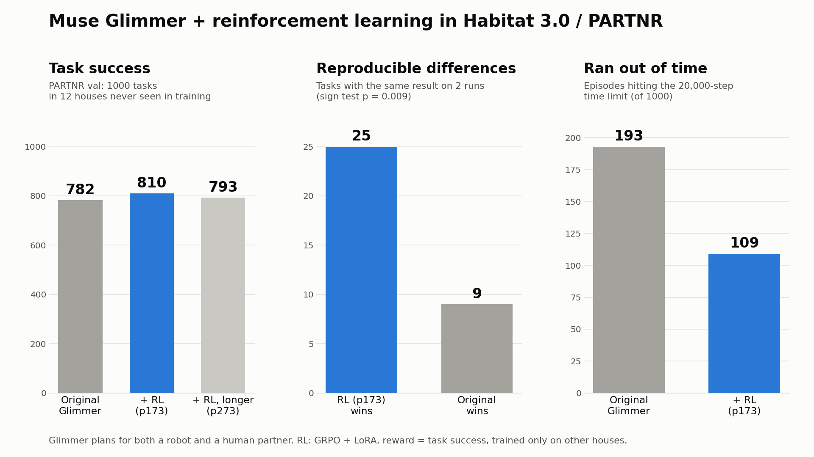

# Muse Glimmer + RL: an open model that plans better for a robot working alongside a person

Home robots will have to plan in houses they have never seen, next to people who are doing their own share of the
work. This project takes **Muse Glimmer 30B** (Meta open weights), makes it the planner for both agents in Meta's
**PARTNR** benchmark (Habitat 3.0: a Spot robot and a simulated human rearrange, clean, fill and switch on objects in
realistic homes from a natural-language task), and improves it with **reinforcement learning in simulation**: no human
demonstrations or labels, only "did the task get done".

**Project page (videos, explorer of all 1000 test episodes):** `<GitHub Pages URL>` ·
**3-minute demo:** `<YouTube URL>` · **LoRA adapter:** `<Hugging Face URL>`

## Results

PARTNR val: 1000 tasks in 12 houses that never appear in training (no public test split exists, so val is our test
set; checkpoints were picked on held-out training houses).

| Planner | Success (of 1000) | Share of task conditions done | Episodes at the 20,000-step limit |
|---|---|---|---|
| Muse Glimmer 30B | 782 | 0.871 | 193 |
| **Muse Glimmer 30B + RL (adapter `p173`, 173 updates)** | **810** | **0.893** | **109** |
| + RL, 100 more updates (`p273`) | 793 | 0.876 | 99 |

- **Paired on the same 1000 tasks**, p173 vs the original: +2.8 points (SE 1.1); better on 76 tasks, worse on 48;
  sign test p = 0.015. Better in 9 of the 12 houses.
- **Re-run check.** Each number above is one greedy run per task, and greedy runs are not exactly reproducible. We
  re-ran the 196 tasks where the three models disagreed, plus 20 where they agreed. Agreeing tasks reproduced 60/60;
  among tasks with the same result on both runs, **p173 beats the original on 25 and loses on 9 (p = 0.009)**. With
  the re-run averaged in: original 796, p173 820.5, p273 799.
- Training longer at the same settings drifted (policy entropy roughly tripled) and gave back most of the gain:
  p273 is not better than the original after the re-run check. p173 is the released checkpoint.
- For reference, the PARTNR paper reports 0.73 for its ReAct Llama-3.1-70B planner and 0.93 for humans (on its own
  setup, so not strictly comparable).



## What we built (all during the hackathon, Oct 29 – Nov 4, 2026)

1. **Glimmer as a native PARTNR planner** (`src/muse_habitat/native_tools.py`, `vllm_llm.py`): PARTNR's skills
   (navigate, explore, pick, place, rearrange, clean, fill, power on/off, ...) exposed as Glimmer tools. Each turn the
   model thinks in its reasoning channel and makes one native tool call; PARTNR's motion skills execute it.
   Baseline: 782 / 1000 on val (`baselines/glimmer_c1_low_val/`, `docs/reports/baseline.md`).
2. **Online GRPO with LoRA on a 30B model**, end to end:
   - **Group rollouts** (`scripts/partnr_groups.sh`): 8 samples of the same training task at temperature 1; reward
     = task success, shared by robot and human; advantage = reward relative to the group.
   - **Token-level trajectory logging** from the vLLM backend: prompt and generated token ids and log-probs of every
     turn, so training uses exactly what was sampled.
   - **Prefix-shared turn packing** (`src/muse_habitat/turn_packing.py`): all turns of one agent's episode go into
     one sequence, the shared history once and each turn's generated tokens at their own positions, with an
     attention mask that reproduces each turn's view. 12.7x fewer tokens than one sequence per turn.
   - **Clipped policy-gradient loss** on the agents' own tokens only (`src/muse_habitat/grpo.py`).
   - **Streaming loop** (`scripts/grpo_run.py`): 24 Habitat rollouts run continuously; after each update the new
     LoRA adapter is loaded into the running vLLM servers and rollouts switch to it on their next turn.
   - **Fast serving of LoRA adapters with speculative decoding**: Glimmer + its DFlash drafter
     (`Muse-Glimmer-30B-assistant`) + runtime-loaded adapters in vLLM (`scripts/glimmer_serve_lora.sh`), checked
     against the trainer's log-probs (`scripts/lora_check.py`, `lora_specdec_check.py`).
   - **Two-machine setup**: Habitat and the trainer on one machine; inference on another, over an SSH tunnel,
     adapters synced by rsync (`scripts/tunnel.sh`).
3. **Evaluation that holds up**: a train / dev split of PARTNR train kept apart from val (`src/muse_habitat/splits.py`,
   `data/splits/`), paired comparisons with sign tests, multi-GPU eval (`scripts/dev_eval.sh`), and the re-run check
   above.

About 30 hours of training in total; 4 restarts from saved adapter + optimizer state.

## How it works

```
 PARTNR task ("Move the jug and cup to the kitchen and fill the jug")
        │
 Habitat 3.0 house ──observations──▶ Muse Glimmer (robot) ──tool call──▶ PARTNR skills ──▶ simulator
                   ──observations──▶ Muse Glimmer (human) ──tool call──▶ PARTNR skills ──▶ simulator
        │
 task success (0/1) for 8 rollouts of the same task ──▶ GRPO update of a LoRA adapter ──▶ served to the next rollouts
```

Low-level motion is idealized in PARTNR (the robot base slides along the navigation mesh, grasps snap); the model's
job is the high-level plan: what to look for, where things go, who does what.

## Layout

| Path | What |
|---|---|
| `src/muse_habitat/native_tools.py` | `NativeToolsPlanner`: PARTNR skills as Glimmer tools |
| `src/muse_habitat/vllm_llm.py` | PARTNR LLM backend on vLLM's completions API; trajectory logging for RL |
| `src/muse_habitat/grpo.py`, `turn_packing.py` | GRPO data, advantages, packing, loss |
| `src/muse_habitat/splits.py`, `data/splits/` | train pool / dev split of PARTNR train, kept apart from val |
| `src/muse_habitat/results.py` | summarize PARTNR result CSVs |
| `scripts/grpo_run.py` | the streaming GRPO trainer |
| `scripts/partnr_groups.sh`, `partnr_run.sh`, `partnr_shards.sh` | rollouts and evals |
| `scripts/dev_eval.sh` | greedy eval of a served model or adapter on dev or val |
| `scripts/glimmer_serve_lora.sh` | vLLM serving: Glimmer + DFlash + LoRA adapters |
| `scripts/traj_transcript.py`, `scripts/site_data.py` | readable per-turn transcripts; project page data |
| `conf/` | Hydra configs on PARTNR's search path |
| `docs/` | project page (GitHub Pages) and reports |
| `tests/` | packing and GRPO tests |

## Running it

Needs PARTNR (`facebookresearch/partnr-planner`, unmodified, with its data and its Python env), a vLLM env, and the
Glimmer weights in the Hugging Face cache; see `scripts/env.sh` and `scripts/setup_envs.sh`.

```
TP=2 DFLASH=1 scripts/glimmer_serve_lora.sh 0,1 8021        # Glimmer + DFlash + LoRA serving on 2 GPUs
curl -X POST localhost:8021/v1/load_lora_adapter -H 'Content-Type: application/json' \
     -d '{"lora_name": "p173", "lora_path": "<adapter dir>"}'
SPLIT=val scripts/dev_eval.sh val_p173 0,1 8021,8021 p173   # full val with the adapter
python3 scripts/grpo_run.py <run name> --port 8021 ...      # training; see the script's arguments
```
