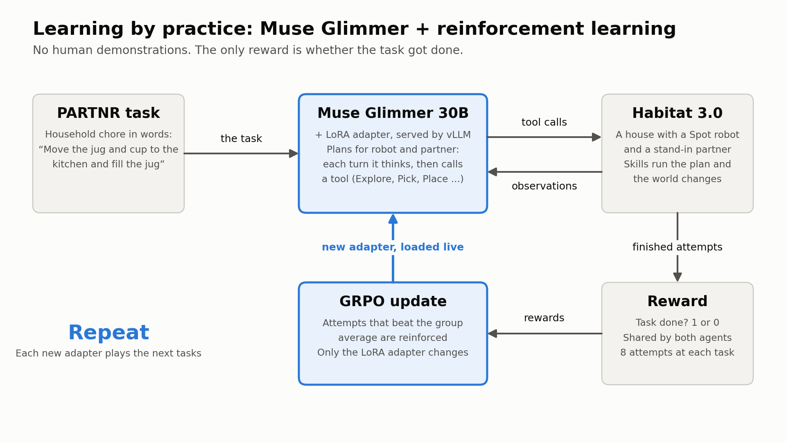
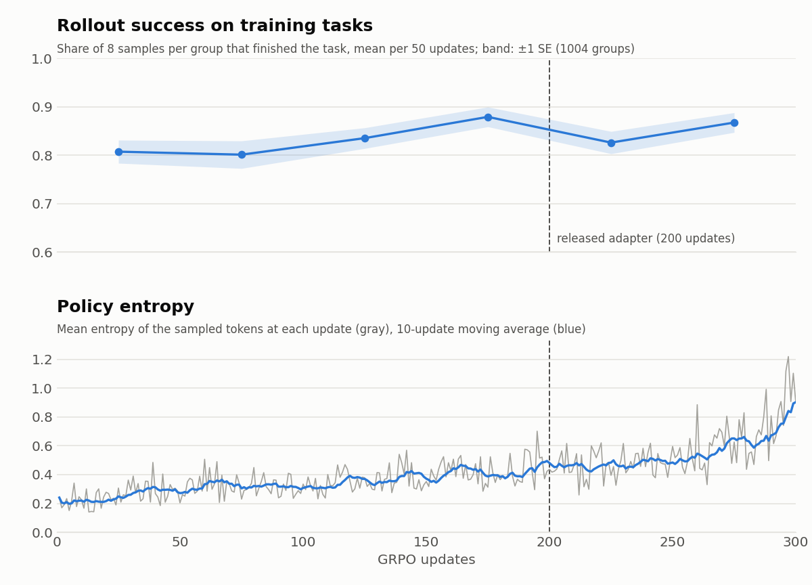

# Muse Glimmer + RL: an open model that plans better for a robot working alongside a person

**[Project page](https://muse-habitat.georgesung.com/)** | **[Demo video](https://youtu.be/yy8IwvziNfA)** | **[LoRA adapter](https://huggingface.co/georgesung/Muse-Glimmer-30B-Habitat-PARTNR-Lora)** | **[Engineering details](docs/engineering.md)**

Home robots will have to plan in houses they have never seen, next to people who are doing their own share of the
work. This project takes **Muse Glimmer 30B** (Meta open weights), makes it the planner for both agents in Meta's
**PARTNR** benchmark (Habitat 3.0: a Spot robot and a simulated human rearrange, clean, fill and switch on objects in
realistic homes from a natural-language task), and improves it with **reinforcement learning in simulation**: no human
demonstrations or labels, only "did the task get done".

## Results

PARTNR val: 1000 tasks in 12 houses that never appear in training (no public test split exists, so val is my test
set; the released adapter was chosen on a dev split of PARTNR train before its val run, and one later checkpoint
was also run on val; see "Training curves and checkpoints" below).

| Planner | Success (of 1000) | Share of task conditions done | Episodes at the 20,000-step limit |
|---|---|---|---|
| Muse Glimmer 30B | 782 | 0.871 | 193 |
| **Muse Glimmer 30B + RL** | **810** | **0.893** | **109** |

- **Paired on the same 1000 tasks**, RL vs the original: +2.8 points (SE 1.1); better on 76 tasks, worse on 48;
  sign test p = 0.015. Better in 9 of the 12 houses.
- **Re-run check.** Each number above is one greedy run per task, and greedy runs are not exactly reproducible. I
  re-ran the 196 tasks where the models disagreed, plus 20 where they agreed. Agreeing tasks reproduced 60/60; among
  tasks with the same result on both runs, **RL beats the original on 25 and loses on 9 (p = 0.009)**. With the re-run
  averaged in: original 796, RL 820.5.
- For reference, the PARTNR paper reports 0.73 for its ReAct Llama-3.1-70B planner and 0.93 for humans (on its own
  setup, so not strictly comparable).


## What I built (all during the hackathon, Oct 29 – Nov 4, 2026)

1. **Glimmer as a native PARTNR planner** (`src/muse_habitat/native_tools.py`, `vllm_llm.py`): PARTNR's skills
   (navigate, explore, pick, place, rearrange, clean, fill, power on/off, ...) exposed as Glimmer tools. Each turn the
   model thinks in its reasoning channel and makes one native tool call; PARTNR's motion skills execute it.
   Baseline: 782 / 1000 on val (`baselines/glimmer_c1_low_val/`, `docs/reports/baseline.md`).
2. **Online GRPO with LoRA on a 30B model**, end to end:
   - **Group rollouts** (`scripts/partnr_groups.sh`): 8 samples of the same training task at temperature 1; reward
     = task success, shared by robot and human; advantage = reward relative to the group.
   - **Token-level trajectory logging** from the vLLM backend: prompt and generated token ids and log-probs of every
     turn, so training uses exactly what was sampled.
   - **Prefix-shared turn packing** (`src/muse_habitat/turn_packing.py`): all turns of one agent's episode go into
     one sequence, the shared history once and each turn's generated tokens at their own positions, with an
     attention mask that reproduces each turn's view. 12.7x fewer tokens than one sequence per turn.
   - **Clipped policy-gradient loss** on the agents' own tokens only (`src/muse_habitat/grpo.py`).
   - **Streaming loop** (`scripts/grpo_run.py`): 24 Habitat rollouts run continuously; after each update the new
     LoRA adapter is loaded into the running vLLM servers and rollouts switch to it on their next turn.
   - **Fast serving of LoRA adapters with speculative decoding**: Glimmer + its DFlash drafter
     (`Muse-Glimmer-30B-assistant`) + runtime-loaded adapters in vLLM (`scripts/glimmer_serve_lora.sh`), checked
     against the trainer's log-probs (`scripts/lora_check.py`, `lora_specdec_check.py`).
   - **Two-machine setup**: Habitat and the trainer on one machine; inference on another, over an SSH tunnel,
     adapters synced by rsync (`scripts/tunnel.sh`).
3. **Evaluation that holds up**: a train / dev split of PARTNR train kept apart from val (`src/muse_habitat/splits.py`,
   `data/splits/`), paired comparisons with sign tests, multi-GPU eval (`scripts/dev_eval.sh`), and the re-run check
   above.

About 30 hours of training in total; 4 restarts from saved adapter + optimizer state.

**[Engineering details](docs/engineering.md)** covers all of this in depth: the trainer (written on PyTorch, PEFT and
transformers; no TRL), the packing layout and its Triton attention kernel, log-probs without the full logits,
serving LoRA with speculative decoding, the bf16 numerics study, and the checks behind each part.

## Why the model plays both the robot and the human

A robot can't practice thousands of chores with real people, so Glimmer practices with a simulated partner played by a
copy of itself: self-play. The two agents plan separately, each from its own partial view, and have no way to message
each other. All either one sees is things like "book_0: held by the other agent", so each has to work out who is doing
what. The reward is shared, so only teamwork pays. On a real robot, only the robot's side would ship; the partner is a
training tool.

The results above are for the whole team, with both agents running the adapter. I have not measured the robot's share
on its own, and the partner was always simulated: working with real people is the next step.

## How it works



Low-level motion is idealized in PARTNR (the robot base slides along the navigation mesh, grasps snap); the model's
job is the high-level plan: what to look for, where things go, who does what.

## Layout

| Path | What |
|---|---|
| `src/muse_habitat/native_tools.py` | `NativeToolsPlanner`: PARTNR skills as Glimmer tools |
| `src/muse_habitat/vllm_llm.py` | PARTNR LLM backend on vLLM's completions API; trajectory logging for RL |
| `src/muse_habitat/grpo.py`, `turn_packing.py` | GRPO data, advantages, packing, loss |
| `src/muse_habitat/splits.py`, `data/splits/` | train pool / dev split of PARTNR train, kept apart from val |
| `src/muse_habitat/results.py` | summarize PARTNR result CSVs |
| `scripts/grpo_run.py` | the streaming GRPO trainer |
| `scripts/partnr_groups.sh`, `partnr_run.sh`, `partnr_shards.sh` | rollouts and evals |
| `scripts/dev_eval.sh` | greedy eval of a served model or adapter on dev or val |
| `scripts/glimmer_serve_lora.sh` | vLLM serving: Glimmer + DFlash + LoRA adapters |
| `scripts/traj_transcript.py`, `scripts/site_data.py` | readable per-turn transcripts; project page data |
| `data/training_logs/`, `scripts/training_curves.py` | per-update and per-group training logs; the training curves figure |
| `conf/` | Hydra configs on PARTNR's search path |
| `docs/` | project page (GitHub Pages), [engineering details](docs/engineering.md) and reports |
| `tests/` | packing and GRPO tests |

## Running it

Needs PARTNR (`facebookresearch/partnr-planner`, unmodified, with its data and its Python env), a vLLM env, and the
Glimmer weights in the Hugging Face cache; see `scripts/env.sh` and `scripts/setup_envs.sh`.

```
TP=2 DFLASH=1 scripts/glimmer_serve_lora.sh 0,1 8021        # Glimmer + DFlash + LoRA serving
curl -X POST localhost:8021/v1/load_lora_adapter -H 'Content-Type: application/json' \
     -d '{"lora_name": "glimmer-rl", "lora_path": "<adapter dir>"}'
SPLIT=val scripts/dev_eval.sh val_rl 0,1 8021,8021 glimmer-rl   # full val with the adapter
python3 scripts/grpo_run.py <run name> --port 8021 ...      # training; see the script's arguments
```

## Training curves and checkpoints



Training ran for 300 updates in 5 runs, each resumed from the previous run's adapter and optimizer state. Rollout
success on the training tasks (top) rose from about 0.80 in the first 100 updates to 0.88 by updates 150–199, then
became noisy; every rollout group is a different task, so read this as a trend only. Policy entropy (bottom) rose
the whole way, and faster after 200 updates: about 0.22 at the start, 0.48 at 200 and 0.90 at 300 (mean of 10
updates). The raw logs are in `data/training_logs/`, and `scripts/training_curves.py` redraws the figure.

I evaluated four checkpoints with greedy decoding:

| GRPO updates | Dev (300 tasks of PARTNR train) | Val (1000 tasks) |
|---|---|---|
| 0 (original Glimmer) | 246 | 782 |
| 101 | 253 | – |
| **200 (released)** | **255** | **810** |
| 300 | 258 | 793 |

Crashed episodes count as failures (1–3 per checkpoint on dev, up to 14 on val). On dev the checkpoints are within
noise of each other (200 vs 300: 20 tasks better, 17 worse). I picked the 200-update adapter on dev and ran it on val
once. Training then continued to 300 updates; that checkpoint scored a little higher on dev, so it was also run on
val, where it scored lower, and I release the 200-update adapter. That last choice used val, so 810 is not a fully
untouched test number. Had I released the 300-update adapter, the gain over the original would be 11 tasks instead
of 28, and not significant (p = 0.41).

More detail on the 300-update checkpoint:

| | 200 updates (released) | 300 updates |
|---|---|---|
| Val success (of 1000) | 810 | 793 |
| With re-runs averaged in | 820.5 | 799 |
| Share of task conditions done | 0.893 | 0.876 |
| Episodes at the 20,000-step limit | 109 | 99 |

The extra 100 updates at the same settings let entropy nearly double and gave back most of the gain: it finishes
episodes sooner but fails more of them outright, and after the re-run check it is not better than the original
(13 wins, 16 losses). Lowering the learning rate or adding an entropy or KL penalty is the obvious next try.

**Names in run directories.** Training saved numbered adapters as it went: `p173` is the released adapter (200
updates), and `p273` is the 300-update one. The number is a step counter that leaves out the first 27 updates, so
it is not the update count.

## Limitations

- **Simulated partner only.** The model plays both agents, and every result is for that team. I have not measured
  the robot's share on its own, or tested with real people.
- **One greedy run per task.** Greedy decoding in this stack is not exactly reproducible, which is why I re-ran
  the disagreements. Rollout success during training is at temperature 1 on different tasks each time.
- **Idealized motion.** PARTNR's low-level skills are idealized (the base slides along the navigation mesh, grasps
  snap), so this measures planning, not control.
- **Short training.** About 30 hours and 300 updates with a single set of hyperparameters, and training drifted
  after 200 updates.

## License

The code in this repository is licensed under Apache 2.0 (see `LICENSE`). Copyright 2026 Jou-ching (George) Sung.
PARTNR, Habitat and Muse Glimmer keep their own licenses.
