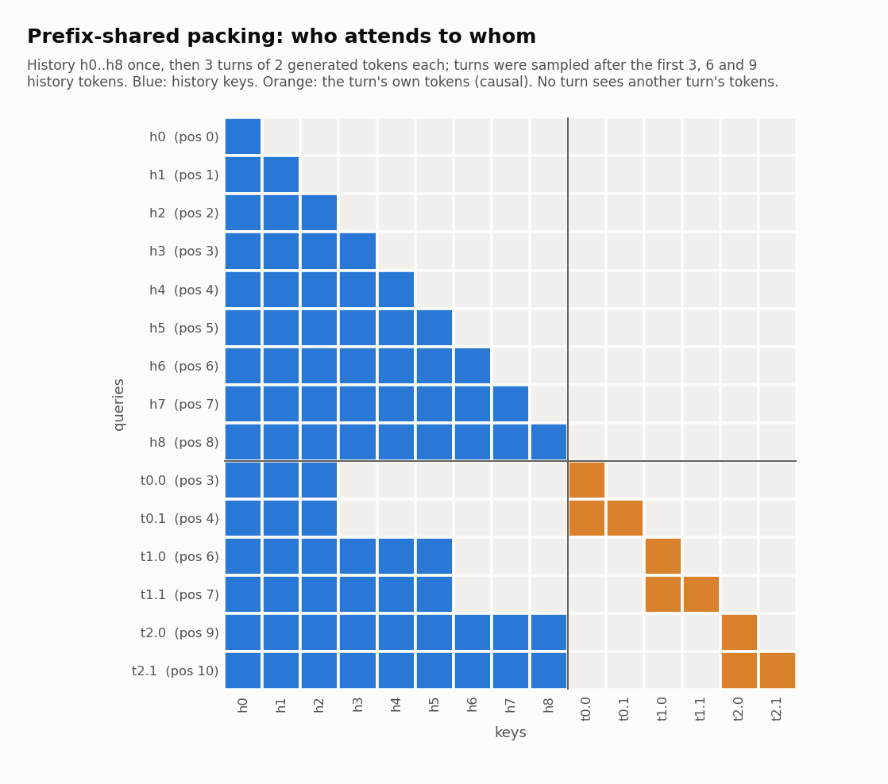

# Engineering details

How the RL pipeline behind Muse Glimmer + RL works: the planner interface, the streaming GRPO loop, the training
loss, prefix-shared packing and its attention kernel, serving LoRA adapters with speculative decoding, and the checks
that each part does what it should. For results, see the [README](https://github.com/georgesung/muse-habitat#readme)
and the [project page](https://muse-habitat.georgesung.com/).

Packing the turns of a multi-turn episode so the shared history is computed once is a known idea from public work;
the implementation here (the range computation, the Triton kernel, the log-prob path and the training integration)
was written for this project.

## Overview

```
┌──────────────────────── machine A ────────────────────────┐        ┌───── machine B ─────┐
│ 24 PARTNR / Habitat rollout processes                     │  HTTP  │ 2 vLLM servers      │
│ (8 samples x 3 shards, temperature 1)  ───────────────────┼───────►│ Glimmer 30B         │
│     │ trajectories: prompt + generated token ids,         │  (SSH  │ + DFlash drafter    │
│     │ sampled log-probs, one JSON line per call           │ tunnel)│ + LoRA adapters     │
│     ▼                                                     │        │   loaded at runtime │
│ GRPO trainer (1 GPU, bf16 Glimmer + LoRA)                 │        └──────────▲──────────┘
│     │ new adapter after every update ─────────────────────┼─── rsync + load ──┘
│     └─► policy file: every rollout process switches to    │
│         the new adapter on its next LLM call              │
└───────────────────────────────────────────────────────────┘
```

The stack is PyTorch, transformers, PEFT and Triton for training, vLLM 0.32 for inference, and PARTNR and Habitat
3.0, unmodified, for tasks, skills and scoring. The trainer does not use TRL: TRL's trainers build one sequence per
sample, and packing all turns of an episode into one sequence needs a custom attention pattern and control over how
log-probs are computed. The trainer is about 500 lines (`scripts/grpo_run.py`, `src/muse_habitat/grpo.py`) on top
of the packing module.

| Part | Code |
|---|---|
| Planner with native tool calling | [`src/muse_habitat/native_tools.py`](https://github.com/georgesung/muse-habitat/blob/main/src/muse_habitat/native_tools.py) |
| vLLM backend, trajectory logging, policy switching | [`src/muse_habitat/vllm_llm.py`](https://github.com/georgesung/muse-habitat/blob/main/src/muse_habitat/vllm_llm.py) |
| Groups, advantages, packs, loss, training step | [`src/muse_habitat/grpo.py`](https://github.com/georgesung/muse-habitat/blob/main/src/muse_habitat/grpo.py) |
| Prefix-shared packing, attention routing, chunked log-probs | [`src/muse_habitat/turn_packing.py`](https://github.com/georgesung/muse-habitat/blob/main/src/muse_habitat/turn_packing.py) |
| Triton attention kernel over key ranges | [`src/muse_habitat/ranged_attn.py`](https://github.com/georgesung/muse-habitat/blob/main/src/muse_habitat/ranged_attn.py) |
| Streaming trainer | [`scripts/grpo_run.py`](https://github.com/georgesung/muse-habitat/blob/main/scripts/grpo_run.py) |
| Serving | [`scripts/glimmer_serve_lora.sh`](https://github.com/georgesung/muse-habitat/blob/main/scripts/glimmer_serve_lora.sh) |
| Checks | `scripts/pack_check.py`, `lora_check.py`, `lora_specdec_check.py`, `grad_truth.py`, `serve_bench.py`, `tests/` |

## The planner interface

PARTNR's planners keep one prompt string and parse `Tool[args]` lines from a ReAct-style reply. Glimmer has its own
interface: a reasoning channel and native tool calls. `NativeToolsPlanner` keeps the episode as Glimmer's own chat
turns, rendered byte for byte as its chat template renders a conversation with `tools=`:

- PARTNR's skills (Explore, Navigate, Pick, Place, Rearrange, Open, Close, Clean, Fill, Pour, PowerOn, PowerOff,
  Wait) and Done become functions with JSON schemas in the system block. Each agent gets only its own skills: the
  robot cannot clean, fill, pour or switch things on.
- Each turn, the model thinks in its reasoning channel and then writes one call, in a single generation that stops
  at `</atem:function_calls>`. The call is parsed and turned back into `Tool[a, b]` for the rest of PARTNR, so
  execution and scoring are unchanged.
- Skill results come back as `tool` messages.
- A turn without a parseable call falls back to a grammar-constrained path (recipient and argument values limited to
  the agent's tools and the names in its world graph). It is rarely needed: 1,727 calls on 40 evaluation episodes
  were all well formed, and training hit it 5 times in about 250k turns. Fallback turns are context only, not
  training samples.

I compared four interfaces before training (ReAct with the paper's grammar, native thinking plus a constrained
answer, constrained native tool calls, and the single unconstrained generation); see
[`docs/reports/baseline.md`](https://github.com/georgesung/muse-habitat/blob/main/docs/reports/baseline.md). The
single generation was kept because it is the model's own format and needs no grammar. Its full val score, 782 of
1000, is the baseline.

**One property matters for training.** As chat clients do, the planner drops earlier turns' reasoning from the
history. Then each turn's prompt is the previous prompt plus the previous call and its result, so the prompts of
one agent's episode are strict prefixes of each other. I checked this on real logs (108 of 108 turns) and the
trainer asserts it for every pack. Packing depends on it.

### Trajectory logging and policy switching

`VLLMCompletion` sends raw completion requests to vLLM. With `MUSE_TRAJ_DIR` set, it asks for token ids and
log-probs (`return_token_ids`, `logprobs=0`) and appends one JSON line per call: the episode, agent and turn, the
prompt and generated token ids exactly as vLLM saw and sampled them, the sampled tokens' log-probs and the served
model name. Training uses these token ids directly and never re-tokenizes text.

With `MUSE_POLICY_FILE` set, every call reads the served model name (the current adapter) from that file. A
long-running PARTNR process therefore follows policy updates from its next turn, without restarting.

## The streaming GRPO loop

`scripts/grpo_run.py` starts 24 PARTNR processes and the trainer, then never stops the rollouts.

- **Groups.** Episodes are a seeded sample of the training pool, split into 3 shards. All 8 processes of a shard
  play the same episodes in the same order (Habitat's episode shuffling and scene grouping are turned off), so the 8
  samples of an episode form a GRPO group. A group is complete when every process of its shard has a result for that
  episode or has moved past it (PARTNR skips episodes that crash).
- **Updates.** The trainer polls the trajectory logs, reading only lines appended since the last poll. When a group
  completes and its rewards are not all equal, it takes one update on that group. About 30% of groups had a reward
  spread (304 of 1,007 over the whole training run); the rest carry no signal and are skipped.
- **Publishing.** After each update the trainer saves the adapter and the optimizer state, copies the adapter to the
  inference machine with rsync, loads it into both vLLM servers (`/v1/load_lora_adapter`), and then atomically
  rewrites the policy file. The last 3 adapters stay loaded, so turns that are already in flight finish on the
  adapter they started with; older ones are unloaded.
- **Off-policy by design.** An episode takes several updates to finish, so one group's turns are sampled by several
  successive adapters (7 per group at the median). The loss uses the log-probs logged at sampling time, so each
  token's importance ratio is taken against the adapter that actually produced it. The mean deviation of that ratio
  from 1 stayed at 0.5–5% per update (median 1.3%), so the clipping rarely triggers.
- **Restarts.** `--init`, `--init-opt` and `--start-step` resume from a saved adapter and optimizer state with the
  same numbering. The 300 updates ran as 5 runs: an out-of-memory crash (the first run saved no optimizer state, so
  Adam restarted from zero once), two pauses for evaluation, and a stop to fix a bug where fallback turns were
  treated as training samples.

The rollouts set the pace, not the trainer. Groups completed at about 17–23 per hour, giving about 6–9 updates per
hour, and the trainer was busy for 13 of the 42 hours.

## The training objective

For a group of 8 rollouts with rewards *r*ᵢ (task success, 0 or 1, shared by the robot and the partner), the
advantage of rollout *i* is

```
A_i = (r_i - mean(r)) / (std(r) + 1e-6)
```

and every generated token of both agents in that rollout gets *A*ᵢ. Only the model's own tokens (reasoning and call)
are trained; prompts and tool results are context only, but gradients still flow through the whole context. The loss
is the clipped policy-gradient objective of [PPO](https://arxiv.org/abs/1707.06347), as used by
[GRPO](https://arxiv.org/abs/2402.03300), with the ratio against the logged sampling log-probs:

```
ratio = exp(logp_current - logp_sampled)
loss  = -sum over tokens of min(ratio * A, clip(ratio, 1 - 0.2, 1 + 0.28) * A)  /  (tokens in the update)
```

- The clip range is asymmetric (0.2 below, 0.28 above), so tokens with positive advantage can gain probability a
  little faster than the usual symmetric range allows. This is [DAPO](https://arxiv.org/abs/2503.14476)'s "clip-higher".
- The loss is averaged per token over the whole update, so long episodes are not down-weighted per token (also
  from DAPO).
- There is no KL penalty and no reference model. That saves a second copy of the model and a forward pass per pack.
  In hindsight the drift after 200 updates suggests a KL or entropy term would have helped; see the
  [training curves](https://github.com/georgesung/muse-habitat#training-curves-and-checkpoints).
- AdamW, learning rate 1e-5, betas (0.9, 0.99), no weight decay, gradient norm clipped at 1.0, one group per update.
- LoRA rank 32, alpha 64, on q/k/v/o and the MLP's gate/up/down projections of every text layer (see
  [LoRA and the attention output gate](#lora-and-the-attention-output-gate) for why not the attention gate).

## Prefix-shared turn packing

### The problem

A PARTNR episode is a few dozen turns per agent. Trained the usual way, every turn is a separate sample: its full
prompt (system block with tool definitions, task, the history so far) plus its generated tokens. Prompts grow every
turn and are mostly the same text: an episode's final prompts plus generated tokens are about 12k tokens, but its
per-turn samples add up to about 165k, about 3 minutes of training compute per episode, or close to half an hour per
group of 8.

### The layout

Because one agent's prompts are strict prefixes of each other (see [the planner interface](#the-planner-interface)),
all of that agent's turns can share one copy of the history:

```
[ history (the last turn's prompt) | turn 0's generated tokens | turn 1's | ... | turn K's ]
```

- The history is the last turn's prompt, so it contains every earlier prompt as a prefix.
- Turn *k*'s generated tokens (reasoning and call) take position ids *h*ₖ, *h*ₖ+1, ..., where *h*ₖ is the length of
  the prompt turn *k* was sampled from. Rotary embeddings (and the sliding windows) then see exactly the positions
  the model saw at sampling time.
- Turn *k*'s tokens attend to the first *h*ₖ history tokens and to their own earlier tokens, and to nothing else.
  That is exactly the context turn *k* was generated from.
- History rows attend causally to the history, as in a normal forward pass.



The figure is drawn from the repo's own range code on a toy pack. Note that turn *k*'s generated reasoning is not
part of later prompts (it was dropped from the history), so it appears once, in its own segment. The call text does
reappear in later prompts as plain context.

The log-prob of turn *k*'s first generated token is read from the hidden state of history row *h*ₖ − 1 (the last
prompt token it saw), and each later token from the previous row of its own segment. `build_pack` returns those
row indices.

### Budget and chunking

An agent's turns go into one pack if its length (last prompt plus all generated tokens) fits in 12,288 tokens.
Longer episodes are cut into consecutive chunks of turns, each packed against its own last prompt. Each rollout
gives one or more packs per agent. One update over a group of 8 rollouts was 12 to 154 packs (median 17) and 12k to
130k tokens (median 35k).

### Results

`scripts/pack_check.py` compares the two ways on one real agent branch: 22 turns, a 6,313-token history and 1,912
generated tokens, on Glimmer 30B in bf16 with a LoRA adapter.

| | Per-turn samples | Packed |
|---|---|---|
| Forward + backward | 110 s | 8.7 s (12.7× faster) |
| Peak memory | 65 GiB | 70 GiB |
| Log-probs vs vLLM's sampled log-probs (mean abs) | 0.0088 nats | 0.0086 nats |

Packed and per-turn log-probs differ by 0.0034 nats on average (0.14 at most). On a small fp32 model of the same
architecture, packed and per-turn gradients match exactly. On the real model in bf16 they do not: LoRA gradients in
the lower layers differ a lot (cosine similarity 0.26 over all LoRA tensors). Switching between two stock attention
implementations on the same per-turn samples gives differences of the same size, so this is bf16 numerics rather
than the packing; see [Numerics](#numerics-bf16-vs-fp32-gradients).

## The ranged attention kernel

The packed attention pattern is not causal, not block-diagonal, and not a standard sliding window, so stock
FlashAttention or SDPA kernels cannot run it without a dense mask. A dense mask over a 12k-token pack is 150M
entries per layer and forces the slow, memory-heavy attention path. Instead, `ranged_attn.py` is a Triton
FlashAttention-style kernel where each query row attends to at most two contiguous key ranges:

```
query row i attends key j  if  qa_lo[i] <= j <= qa_hi[i]  or  qb_lo[i] <= j <= qb_hi[i]
```

- A turn's row uses range A for its history prefix and range B for its own segment. A history row uses range B
  (causal) and an empty range A.
- **Two kinds of layers.** Glimmer has 52 layers: 39 with a 2,048-token sliding window and 13 with full attention.
  The window is folded into the ranges (`_ranges` clips them), so the same kernel serves both, with two sets of
  ranges per pack.
- **Grouped-query attention inside the kernel.** Glimmer has 32 query heads and 2 key/value heads. The kernel maps
  each query head to its key/value head instead of repeating K and V 16 times in memory.
- **Forward.** For each block of query rows, the kernel loops over the key blocks covering range A, then those
  covering range B, with the usual online softmax. It skips everything else, so cost grows with what each row
  actually sees, not with the pack length squared. It stores the log-sum-exp for the backward.
- **Backward.** Three kernels: a preprocessing pass (row-wise dot product of the output and its gradient), a dK/dV
  pass that loops over key blocks, and a dQ pass that loops over query blocks. The dK/dV pass needs the inverse
  question, which query rows can see this key, so `_ranges` also emits two ranges per key row (`ka_*`, `kb_*`).
  These can be supersets; the exact mask always comes from the query side, so a superset costs a little time but
  never changes the result.
- **Layout.** Q/K/V stay in the layout the attention module holds them in, head-major or token-major, and the
  gradients are returned in that same layout. A transposed gradient would reach Glimmer's q/k norms
  non-contiguous, which fused norm kernels may not handle.
- **Tile sizes** depend on the head dimension and the GPU's shared memory, with a smaller fallback configuration.

### Plugging it into transformers

The kernel goes in without editing the model code. `install_packed_attention` wraps transformers' registered
attention functions (`flash_attention_2`, `sdpa`) in `ALL_ATTENTION_FUNCTIONS`: while a pack is active, the wrapper
calls the ranged kernel with the sliding or full ranges, depending on the layer; otherwise it calls the original
function. The pack is set by a context manager (`active_pack`) that stays open through the backward, because
gradient checkpointing recomputes attention during the backward pass. Glimmer's model code takes position ids, a
per-layer-type attention mask (both left as `None` here) and a tensor `logits_to_keep`, which is all the packed
forward needs.

### Accuracy

`tests/test_turn_packing.py` compares the kernel with a dense fp32 reference across window sizes, head counts and
head dimensions. On Glimmer's real layout, kernel outputs are within 0.3% of dense fp32.

## Log-probs without the full logits

Glimmer's vocabulary has 202,048 tokens. Logits for a 12k-token pack in fp32 would take about 10 GB, plus the same
again for the softmax and its gradient. Only the generated tokens' log-probs are needed, so:

- A forward pre-hook on `lm_head` takes its input hidden states, computes log-probs only for the rows that predict
  generated tokens, and then lets `lm_head` itself project a single row, to keep the model's output contract.
- `chunked_logps` is a custom autograd function. It computes logits, log-softmax, target log-probs and entropy
  1,024 rows at a time and keeps only the hidden states. The backward recomputes each chunk's logits and writes the
  gradient of the hidden states directly, so no full logits tensor exists in either direction.
- **Glimmer's output head is not a plain projection.** It multiplies the logits by `output_multiplier` (0.196) and
  then applies a tanh softcap at 20: `logits = 20 · tanh(0.196 · h·Wᵀ / 20)`. Both have to be reproduced exactly, or
  trainer log-probs disagree with vLLM's and every importance ratio is off. The backward includes the softcap's
  derivative (1 − tanh²).
- Entropy comes out of the same pass at no extra cost; it is logged per update (the bottom panel of the training
  curves).

## Serving: LoRA adapters with speculative decoding

Rollouts are the bottleneck, so inference speed matters. Each vLLM server runs Glimmer 30B in bf16 over 2 GPUs
(tensor parallel) with:

- **DFlash speculative decoding** with `Muse-Glimmer-30B-assistant`, Glimmer's 5-layer drafter, proposing 15 tokens
  at a time. The drafter has no adapter; the target model verifies the draft with the current adapter, so outputs
  follow the adapter's distribution.
- **LoRA adapters loaded at runtime** (`VLLM_ALLOW_RUNTIME_LORA_UPDATING=1`, `--enable-lora --max-lora-rank 64
  --max-loras 4`).
- **Text only** (`--language-model-only`): the vision encoder is never loaded.

Both work together in stock vLLM 0.32, with one constraint: with LoRA enabled, vLLM needs `max_num_batched_tokens ≥
max_num_seqs × (speculative tokens + 1)`, so the serving script caps concurrent sequences at 64.

Throughput on real PARTNR turns (`scripts/serve_bench.py`, temperature 1, turns per minute):

| Requests in flight | No speculation | DFlash, 15 tokens | DFlash, 7 tokens |
|---|---|---|---|
| 8 | 70 | 123 | 114 |
| 16 | 133 | 164 | 161 |
| 24 | 179 | 159 | 161 |

Speculation helps most at low concurrency and stops helping at about 24 requests in flight, where the GPU is
already busy. Each rollout process mostly waits on the simulator, so the servers usually run in the range where it
helps. Evaluation (greedy) also used DFlash.

### Checking that trainer and server agree

The importance ratio only means something if the trainer and vLLM compute the same log-probs for the same tokens.
`scripts/lora_check.py` builds a seeded non-zero adapter in the trainer, loads it into vLLM, samples completions of
real PARTNR turns from vLLM with and without the adapter, and scores the same tokens in the trainer. Per-token
log-probs agree to about 0.007 nats. `scripts/lora_specdec_check.py` repeats the check with DFlash on.

### LoRA and the attention output gate

Glimmer's attention has an output gate, a projection named `self_attn.gate_proj`. vLLM renames that layer, but its
LoRA loader also maps any module ending in `.gate_proj` onto the MLP's packed `gate_up_proj`. An adapter on the
attention gate could therefore be loaded into the wrong layer. The LoRA target pattern leaves the attention gate out
and covers the MLP's `gate_proj` explicitly.

## Numerics: bf16 vs fp32 gradients

Before training, I checked how far bf16 gradients are from fp32 (`scripts/grad_truth.py`). A plain fp32 copy of a
30B model does not fit on one GPU, and over two GPUs the fp32 path itself broke, so the reference is computed layer
by layer: the model stays on the CPU in bf16, each layer is upcast to fp32 on the GPU in turn, the forward keeps
only each layer's input, and the backward recomputes one layer at a time from the top down.

- **Each kernel is correct on its own.** Given fp32 inputs and an fp32 upstream gradient, every bf16 attention
  implementation (SDPA, eager, FlashAttention-2, the ranged kernel) is within about 1% of fp32 per layer.
- **Chained through the model, lower layers drift.** Run end to end in bf16, LoRA gradients in the lower ~20 layers
  differ by 100–200% from fp32, for every kernel, and the kernels disagree with each other by similar amounts. Upper
  layers agree.
- **The cause is the forward pass.** An fp32 forward with a bf16 backward is within 1–17%; a bf16 forward with an
  fp32 backward is as far off as all-bf16. Within the forward, a growing set of tokens have bf16 hidden states that
  diverge from fp32 (16 tokens at layer 12, 144 at layer 24, 392 at layer 40 with more than 30% error). Almost all
  are repeated JSON tokens in the tool definitions of the system prompt. The generated tokens themselves are within
  about 2%.

So this is a property of bf16 on long, repetitive prompts, not a bug in any kernel. I took FlashAttention-2 as the
reference implementation (the ranged kernel agrees with it as closely as other kernels agree with each other) and
did not try to train in fp32.

## Training run statistics

From `data/training_logs/`, over the 300 updates:

| | Min | Median | Max |
|---|---|---|---|
| Seconds per update | 60 | 128 | 2,025 |
| Packs per update | 12 | 17 | 154 |
| Tokens per update | 11.8k | 34.6k | 130k |
| Mean ratio deviation from 1 | 0.5% | 1.3% | 5.0% |
| Clipped tokens | 0% | 0.3% | 5.5% |
| Gradient norm | 0.13 | 0.29 | 1.68 |
| Peak trainer memory (GiB) | 68 | 75 | 78 |

The trainer runs on one GPU, with gradient checkpointing and the 30B base model in bf16. The two vLLM servers and
the 24 Habitat processes run on other GPUs. Sharing the trainer's GPU with simulator processes caused the first
run's out-of-memory crash, so after that the trainer had its GPU to itself.

## Tests and checks

| Check | What it verifies |
|---|---|
| `tests/test_turn_packing.py` | ranged kernel vs dense fp32 attention (windows, head counts, head dims); chunked log-probs with multiplier and softcap vs a direct computation |
| `tests/test_grpo.py` | groups and advantages, chunking and packs, the clipped objective, incremental trajectory reading |
| `scripts/pack_check.py` | packed vs per-turn log-probs, gradients, time and memory on real Glimmer turns |
| `scripts/lora_check.py`, `lora_specdec_check.py` | trainer vs vLLM log-probs with a LoRA adapter, without and with speculative decoding |
| `scripts/grad_truth.py` | layer-by-layer fp32 gradients and how bf16 attention implementations compare |
| `scripts/serve_bench.py` | serving throughput on real turns |

## What I would change next

- **Keep the policy closer to where it started.** Entropy rose steadily and the 300-update adapter was worse on val
  than the 200-update one. A KL penalty toward the original model, an entropy term, or a lower learning rate are the
  first things to try.
- **More signal per rollout.** Only about 30% of groups had a reward spread. Partial credit (PARTNR's share of task
  conditions done), or picking training tasks that the current policy solves some of the time, would waste fewer
  rollouts.
- **Faster rollouts.** The trainer was idle most of the time. More simulator processes per group, or shorter
  episodes, would speed training more than any trainer optimization.
- **Training the robot only.** Both agents run the adapter now. Training the robot's side against a fixed partner
  would separate the robot's own improvement from the team's.
