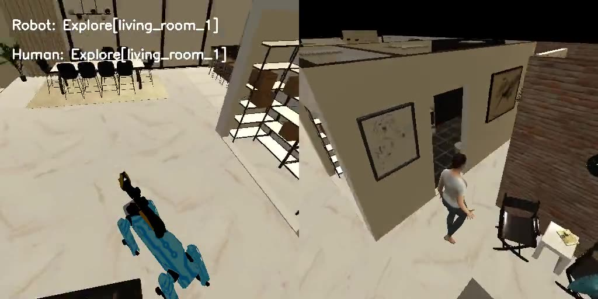
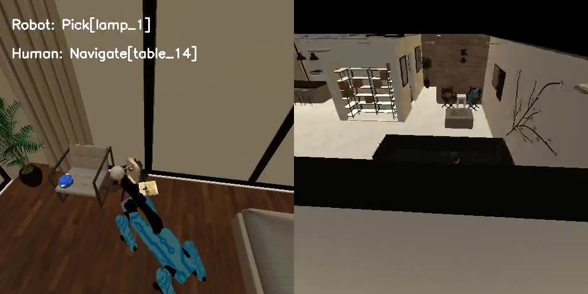
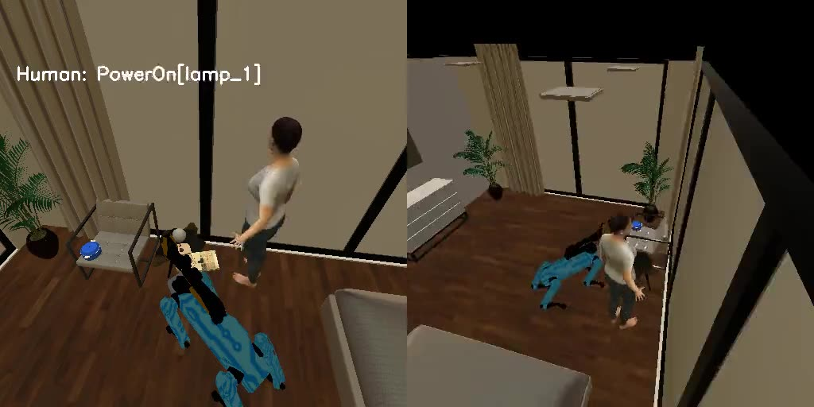
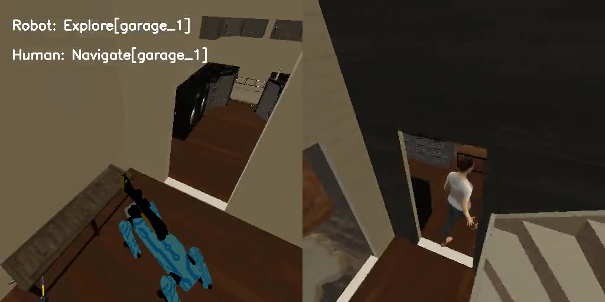
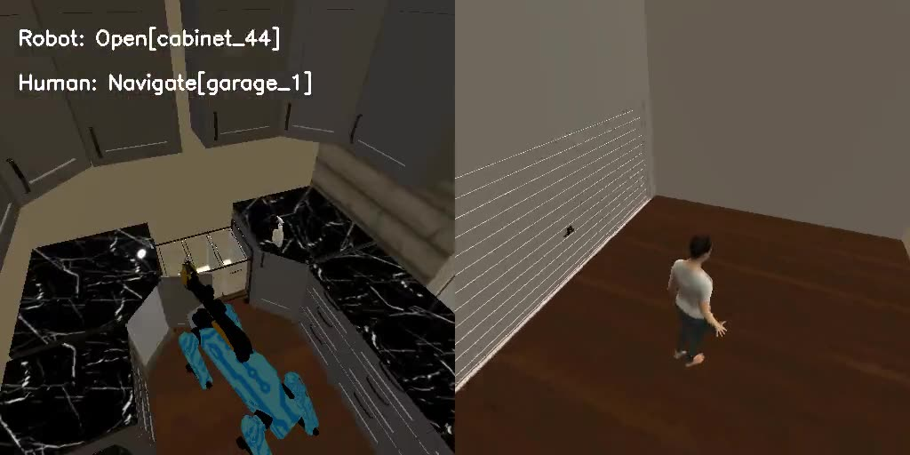
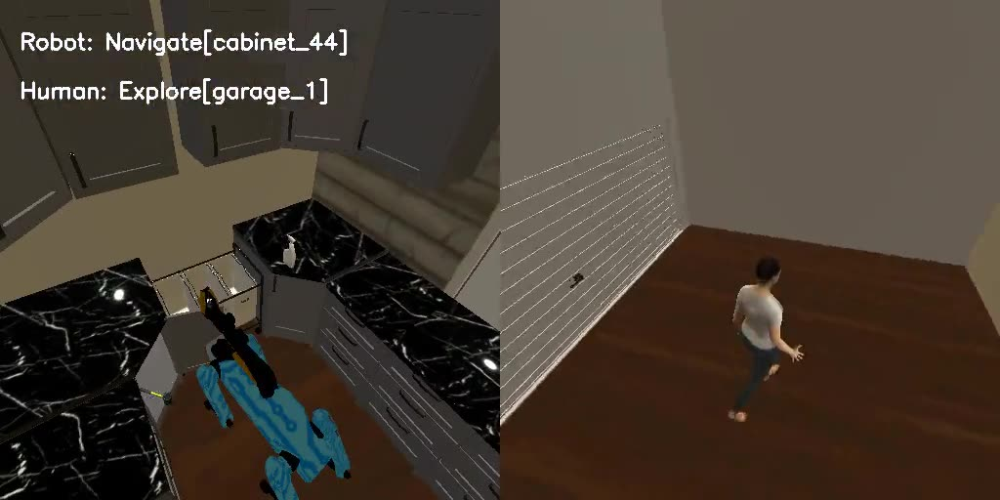

# Actions and observations

What Muse Glimmer sees and does in PARTNR. It plans for both agents: the Spot robot and the simulated human partner.
This page covers the action space of each agent, what an observation contains, every kind of result a skill can
return, and two short episodes turn by turn, with screenshots. For the training side, see
[Engineering details](https://muse-habitat.georgesung.com/engineering.html); for results, see the
[README](https://github.com/georgesung/muse-habitat#readme) and the [project page](https://muse-habitat.georgesung.com/).

Everything quoted here is copied from the logs of real runs: the tool schemas and prompts are the exact text the
model saw, and the counts come from the trajectory logs of training run 3 (updates 102–200, 104,489 calls in 3,071
episodes).

## At a glance

| Aspect | In PARTNR, as run here |
|---|---|
| Agents | 2 per episode: agent 0 is a Spot robot, agent 1 a simulated human. Both are planned by Glimmer, as two separate conversations with the same model and adapter. |
| Model input | Text only. The task, the house's rooms and furniture, the objects the agent knows about, and every earlier call with its result. The model never sees images. |
| Model output | Free-text thinking, then exactly one tool call: a high-level skill with named string arguments, such as `Pick(object="hammer_0")`. |
| Who executes a skill | PARTNR's skill controllers in Habitat 3.0 (path planning, walking, grasping, opening). Glimmer only chooses skills. |
| When an agent is asked | At the start, then each time its previous skill finishes. The two agents act at the same time in the simulator, so their turns interleave. |
| Episode end | Both agents have called `Done`, or 20,000 simulator steps have passed. An agent is also stopped after 50 replans. |
| Reward | Task success, 0 or 1, from PARTNR's evaluation of the final state. It is shared by both agents. |

The screenshots on this page come from PARTNR's episode videos: a camera behind the robot on the left, behind the
human on the right, with the skill each agent is running written at the top. They are for the reader; the model does
not see them.

## How an episode runs

Each agent has its own conversation. The first message gives the task and a description of the house. The agent
calls a skill, the simulator runs it (walking across the house can take hundreds of steps; picking up an object
takes a couple), and the agent then gets the result plus its updated object list. It thinks and calls the next skill.
Meanwhile the other agent is doing the same.

The agents cannot talk to each other. Each learns what the other did only through the world: an object shows up as
`held by the other agent`, or in a new place. The two agents share the same task text, but the prompt tells the robot
it is the "task receiver" and the human it is the "task giver", so in a task such as "you move it and I will wash
it", each knows its part.

On average an agent made 16 (robot) or 18 (human) calls per episode in training. The first prompt is 2,139 to 3,184
tokens long (median 2,624); most of that is the system block with the tool schemas and the furniture list.

## Action space

### Format of one turn

In one generation the model writes its thinking in the reasoning channel, then a single tool call in Glimmer's
native format. This is the robot's turn 9 in episode 438, as generated (on this turn it skipped the thinking, which
it often does on easy steps):

```
<|start|>assistant to=Place<|message|><atem:function_calls>
<atem:invoke name="Place">
<atem:parameter name="object">screwdriver_1</atem:parameter>
<atem:parameter name="spatial_relation">within</atem:parameter>
<atem:parameter name="furniture">cabinet_44</atem:parameter>
<atem:parameter name="spatial_constraint">next_to</atem:parameter>
<atem:parameter name="reference_object">hammer_0</atem:parameter>
</atem:invoke>
```

The call is turned into PARTNR's own form, `Place[screwdriver_1, within, cabinet_44, next_to, hammer_0]`, and
executed. The generation is not constrained, so the model can write any tool name or value; a name that does not
exist comes back as an error result (see [Results](#results-every-kind-of-feedback)).

### Skills

The robot has 8 skills plus `Done`. The human has those 8 plus 5 more that change an object's state, so a task
that says "fill", "clean" or "turn on" needs the human for that part.

| Skill | Robot | Human | Arguments | What it does |
|---|:-:|:-:|---|---|
| `Navigate` | ✓ | ✓ | `target` | Walk to a room, piece of furniture or object. |
| `Explore` | ✓ | ✓ | `room` | Visit the furniture in a room, discovering the objects there. |
| `Pick` | ✓ | ✓ | `object` | Pick up an object. The agent must be close to it and can hold only one object. |
| `Place` | ✓ | ✓ | `object`, `spatial_relation`, `furniture`, `spatial_constraint`, `reference_object` | Put the held object on or in a piece of furniture, optionally next to another object. |
| `Rearrange` | ✓ | ✓ | same as `Place` | Pick, carry and place in one call; walks as needed. |
| `Open` | ✓ | ✓ | `furniture` | Open a cabinet, drawer, fridge and so on. |
| `Close` | ✓ | ✓ | `furniture` | Close it. |
| `Wait` | ✓ | ✓ | none | Stay idle for a while. |
| `Done` | ✓ | ✓ | none | Declare the agent finished. |
| `PowerOn` | | ✓ | `target` | Turn on a powered object, such as a lamp. |
| `PowerOff` | | ✓ | `target` | Turn it off. |
| `Clean` | | ✓ | `target` | Clean an object or furniture. Some objects need a faucet nearby. |
| `Fill` | | ✓ | `object` | Fill an object with water. Needs a faucet nearby. |
| `Pour` | | ✓ | `object` | Pour from the held container into this one. |

Each agent's system block lists only its own skills, as JSON schemas. The robot's `Place`, verbatim except for line breaks:

```json
{
  "name": "Place",
  "description": "Used for placing an object on a target location. You need to provide the name of the object to be placed, the name of the furniture where it should be placed, spatial relation (\"on\" or \"within\") describing the relation between the object and furniture. The object to be placed must already be held by the agent (i.e. picked previously). In addition to these, you can request to place the object near another object. For that you can optionally provide a spatial constraints (\"next_to\") and the name of the reference object. To place next to an object, the reference object must already be on the target furniture. API template - Place[<object_to_be_placed>, <spatial_relation>, <furniture to be placed on>, <spatial_constraint>, <reference_object>]. spatial_constraint and reference_object should be set to \"None\" when necessary.",
  "parameters": {
    "type": "object",
    "properties": {
      "object": {
        "type": "string",
        "description": "Name of an object, as listed in the observations."
      },
      "spatial_relation": {
        "type": "string",
        "description": "Where to place: \"on\" or \"within\"."
      },
      "furniture": {
        "type": "string",
        "description": "Name of a piece of furniture, as listed in the observations."
      },
      "spatial_constraint": {
        "type": "string",
        "description": "\"next_to\" to place next to a reference object, or \"None\"."
      },
      "reference_object": {
        "type": "string",
        "description": "The object or furniture to place next to, or \"None\"."
      }
    },
    "required": [
      "object",
      "spatial_relation",
      "furniture",
      "spatial_constraint",
      "reference_object"
    ]
  }
}
```

The skill descriptions are PARTNR's; the parameter names and their descriptions are mine
([`src/muse_habitat/native_tools.py`](https://github.com/georgesung/muse-habitat/blob/main/src/muse_habitat/native_tools.py)).

### Argument values

| Parameter | Values |
|---|---|
| `spatial_relation` | `on` or `within` (all values) |
| `spatial_constraint` | `next_to` or `None` (all values) |
| `reference_object` | a name of an object or furniture, or `None` |
| `room` | a room of this house, such as `kitchen_1`, `living_room_1`, `bedroom_2`, `laundryroom_1`, `garage_1` |
| `furniture` | furniture of this house, such as `table_16`, `cabinet_44`, `counter_24`, `bench_21`, `chest_of_drawers_36`, `floor_kitchen_1` |
| `object` | an object the agent has seen, such as `hammer_0`, `book_0`, `lamp_1`, `milk_frother_cup_0`, `toy_airplane_0` |
| `target` | for `Navigate`: any room, furniture or object name; for the human's state skills: an object or furniture name |

Names are a category plus an index, and they are only valid in the house they come from. The room and furniture
names are all given in the first message, so that set is finite and known up front. In training run 3 a house had 5 to 23
rooms (median 10) and 17 to 121 pieces of furniture including floors (median 44). Object names appear only once an agent has seen the object. Each room's
floor is furniture too (`floor_kitchen_1`), so objects can be put on the floor.

### What the agents actually did

All calls in training run 3, by agent:

| Skill | Robot | Human |
|---|--:|--:|
| `Navigate` | 14,527 | 15,741 |
| `Explore` | 8,570 | 10,383 |
| `Pick` | 7,756 | 10,205 |
| `Place` | 6,808 | 6,197 |
| `Rearrange` | 4,298 | 2,978 |
| `Wait` | 2,415 | 5,480 |
| `Done` | 2,914 | 2,773 |
| `Open` | 1,013 | 794 |
| `Close` | 94 | 35 |
| `Fill` | | 581 |
| `Clean` | | 514 |
| `PowerOn` | | 298 |
| `PowerOff` | | 107 |
| `Pour` | | 2 |
| Total | 48,401 | 56,088 |

`Pour` is rare because few PARTNR tasks need it. The robot total includes 6 turns with no parseable call.

## Observation space

### The first message

The first user message holds the task, every room with its furniture, the furniture with a faucet, and the objects
found so far. This is episode 882 (both agents get the same message):

```
Task: Move the book from the living room table to the bedroom table and turn on the lamp.

Furniture:
living_room_1: floor_living_room_1, table_14, table_15, couch_23, chair_32, chair_33, unknown_39
bathroom_1: floor_bathroom_1, toilet_30
closet_1: floor_closet_1, shelves_24, shelves_25, shelves_26, shelves_27
workout_1: floor_workout_1
bedroom_1: floor_bedroom_1, table_16, chair_17, bed_22, chest_of_drawers_36, chest_of_drawers_37, chest_of_drawers_38
closet_2: floor_closet_2, chest_of_drawers_40
bathroom_2: floor_bathroom_2, toilet_31
entryway_1: floor_entryway_1, table_29
kitchen_1: floor_kitchen_1, stool_18, stool_19, stool_20, unknown_28, counter_34, cabinet_35, cabinet_41, cabinet_42
dining_room_1: floor_dining_room_1, chair_10, chair_11, chair_12, chair_13, table_21

The following furnitures have a faucet: cabinet_42
Objects:
No objects found yet

Act by calling the tools, one call per turn. Call Done when the task is complete.
```

It comes after a system block with PARTNR's instructions (two agents work on the same task, rooms need exploring
only once, repeated identical calls mean something is wrong), the agent's role, and its tool schemas.

### After each call

The result comes back as a tool message: one result line and the agent's current object list. The human's last
result in episode 882:

```
<tool_output name="PowerOn">
Result: Successful execution!
Objects: cushion_3: chair_32 in living_room_1
book_0: table_16 in bedroom_1
casserole_2: chair_17 in bedroom_1
lamp_1: table_16 in bedroom_1
</tool_output>
```

Each line of the object list takes one of these forms:

| Form | Example |
|---|---|
| `<object>: <furniture> in <room>` | `hammer_0: cabinet_44 in laundryroom_1` |
| `<object>: held by the agent` | `screwdriver_1: held by the agent` |
| `<object>: held by the other agent` | `book_0: held by the other agent` |
| furniture or room not known | `<object>: unknown in <room>`, or `... in an unknown room` |

Before anything is found, the list reads `No objects found yet`.

The conversation keeps every earlier call and result, so the model can see its whole history in the episode. Its
earlier thinking is dropped from the history, as chat clients do.

### What is not observed

- **Images, positions and distances.** The model never sees pixels, coordinates or how far away anything is. It
  finds out it is too far only when a skill fails.
- **Object states.** Whether something is clean, filled or switched on is not in the object list (PARTNR has an option
  to include it, which was off). The model has to remember what it did.
- **Undiscovered objects.** An object appears only after an agent has seen it. The robot's list merges what both
  agents have seen; the human's comes only from its own observations (PARTNR's asymmetric setting).
- **The partner's plan.** Neither agent sees the other's calls, thinking or results.

### Results: every kind of feedback

The result line is either `Successful execution!` or an error. All result kinds seen in training run 3, with names
replaced by `<x>` and close variants merged:

| Result | Count | Typical cause |
|---|--:|---|
| `Successful execution!` | 82,291 | |
| `Failed to pick! Not close enough to the object.` | 5,422 | `Pick` without navigating first (incl. inside `Rearrange`) |
| `Could not find a suitable nav target for <x>. Possibly inaccessible.` | 3,199 | unreachable room or object; mostly `Explore` and `Navigate` |
| `Failed to pick <x>! The arm is currently grasping <x>. Make the agent place the grasped object first.` (and a variant) | 1,798 | already holding something |
| `Failed! This object is held by another agent.` | 1,565 | the partner got there first |
| `Failed to place! Not close enough to <x> or occluded.` | 1,430 | `Place` from too far away |
| `No valid placements found for entity <x>.` (with variants: `next_to` reference not on the furniture; furniture has no receptacle for `on` / `within`) | 715 | impossible placement |
| `Failed to place! The agent is not holding any object.` | 356 | |
| `Failed to Open! <x> is occluded or too far from agent to Open.` (and `Close`) | 305 | |
| `The object is not close enough to a water source` | 250 | `Fill` away from a faucet |
| `Failed! This object is already held by this agent.` | 213 | `Rearrange` of a held object |
| `Skill took too long to finish.` | 223 | a skill hit its time limit |
| `Failed to Open! <x> is not articulated - and cannot be Opened.` (and `Close`) | 156 | opening shelves or a table |
| `Agent too far from object to clean / power on / power off / fill: Distance None` | 202 | human state skill from too far away |
| `Node with name <x> not present in the graph. ...` (and a variant) | 133 | a name that does not exist, such as `dining table` |
| `Incorrect syntax for place/rearrange skill. Spatial_constraint was valid, but corresponding reference_object was none. ...` | 36 | `next_to` without a reference |
| other: `You can't Open a <x>`, `This is not a movable object`, `requires faucet to clean`, `Unable to pour: The held object is not filled`, and 5 more | 51 in all | |

Of the 98,345 calls with a result (every call but `Done` and the last call of an agent's episode), 84% succeeded. Most failures are about being in the right place: `Pick`, `Place`, `Open` and the
human's state skills only work next to their target, while `Navigate`, `Explore` and `Rearrange` move the agent.

## Example traces

Two short episodes from the RL adapter, with each call, the simulator step at which it started, and its result.
All results were `Successful execution!` unless noted. Thinking is quoted from the logs, shortened where marked.

### Episode 882: a lamp only the human can switch on

*Move the book from the living room table to the bedroom table and turn on the lamp.* Success in 3,905 steps.

| Step | Robot | Human |
|--:|---|---|
| 0 | `Explore[living_room_1]` | `Explore[living_room_1]` |
| 824 | `Explore[bedroom_1]` | |
| 1,018 | | `Explore[bedroom_1]` |
| 1,709 | `Rearrange[book_0, on, table_16, None, None]` | |
| 1,844 | | `Navigate[table_15]` |
| 2,288 | | `Navigate[table_14]` |
| 2,446 | `Navigate[table_16]` (book placed: half the task done) | |
| 2,474 | `Pick[lamp_1]` | |
| 2,476 | `Place[lamp_1, on, table_16, None, None]` | |
| 2,478 | `Done[]` | |
| 2,496 | | `Explore[living_room_1]` |
| 3,501 | | `Navigate[table_16]` |
| 3,902 | | `PowerOn[lamp_1]`, then `Done[]` |



*Step 400. Both agents start by exploring the living room, where the book is.*

The robot moves the book in one `Rearrange`. While planning that move it already noticed that the lamp needs a skill
it does not have (turn 2, shortened):

> Lamp is lamp_1 on table_16 in bedroom_1. Need turn on lamp. There's no explicit turn on action listed. ... The
> available tools: Navigate, Pick, Place, Open, Close, Rearrange, Explore, Wait, Done. No turn on.

It picks the lamp up and puts it back, which does nothing, and calls `Done`. Meanwhile the human had gone for the
book, and its object list told it why it was gone (turn 3):

> The other agent already picked up book_0.



*Step 2,475. The book is on the bedroom table and the robot is at the lamp, which it cannot switch on.*

The human then walks to the bedroom table and switches the lamp on, which finishes the task.



*Step 3,903. The human runs `PowerOn[lamp_1]` next to the robot.*

### Episode 438: two tools, next to each other

*Move the hammer and screwdriver from the garage bench to the laundryroom/mudroom cabinet. Place them next to each
other in the cabinet.* Success in 862 steps. The [side-by-side video](https://youtu.be/BEXdAB_hWpw) compares this
run with the original model's.

| Step | Robot | Human |
|--:|---|---|
| 0 | `Navigate[bench_21]` | `Navigate[garage_1]` |
| 107 | `Explore[garage_1]` | |
| 278 | `Pick[hammer_0]` | |
| 280 | `Navigate[cabinet_44]` | |
| 379 | `Open[cabinet_44]` | |
| 382 | `Place[hammer_0, within, cabinet_44, None, None]` | |
| 384 | `Navigate[bench_21]` (hammer placed: 1 of 3 conditions) | |
| 443 | | `Navigate[bench_21]` |
| 502 | `Pick[screwdriver_1]` | |
| 504 | `Navigate[cabinet_44]` | |
| 519 | | `Explore[garage_1]` |
| 611 | `Place[screwdriver_1, within, cabinet_44, next_to, hammer_0]` | |
| 613 | `Done[]` (task complete) | |
| 741 | | `Rearrange[screwdriver_1, within, cabinet_44, next_to, hammer_0]`, then `Done[]` |



*Step 276. The robot reaches the garage bench and picks up the hammer.*

The robot's first object list had the hammer but not the screwdriver, so it explored the garage, picked up the hammer
and took it to the laundry room. The cabinet is closed, so it calls `Open` before `Place`.



*Step 381. The robot has opened `cabinet_44` and is about to place the hammer inside.*

On its second trip it places the screwdriver `next_to` the hammer. That is the last condition, so the task is
complete at step 613. The human was a step behind the whole time. When it arrived, both tools were already in the
cabinet. It worked that out (turn 3: "That suggests they have been moved already? Maybe another agent moved them")
but repeated the placement before calling `Done`. The redundant call does no harm here, but it is the kind of
duplicated work the reward cannot see.



*Step 610. The robot holds the screwdriver at the open cabinet, just before `Place[screwdriver_1, within,
cabinet_44, next_to, hammer_0]`.*
